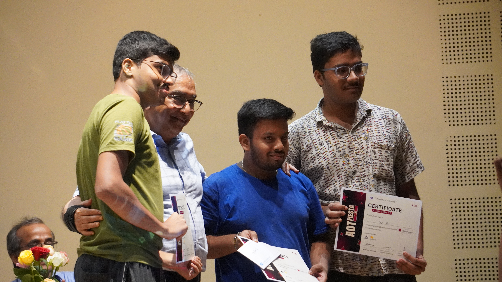
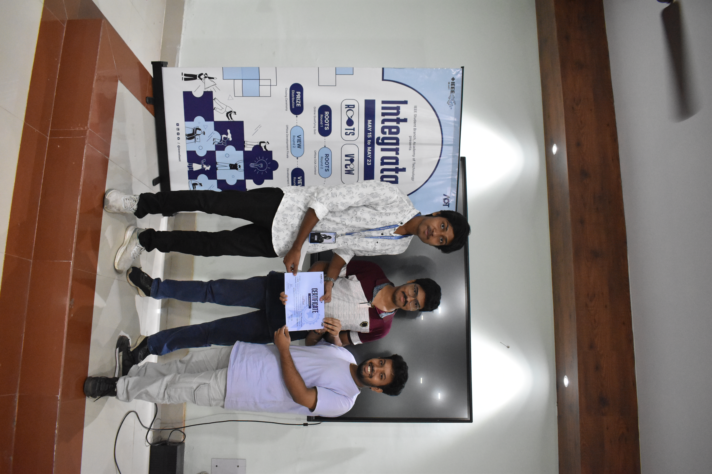

<div align="center">
  
  
  <div align="center">
    
    
    
  </div>
  

  ### 🦾 Robotics Architect · Embedded Systems · Computer Vision & AI

  [](https://git.io/typing-svg)

  <br/>

  [](https://linkedin.com/in/gourab354)
  [](https://instagram.com/user_cooked98)
  [](mailto:gourabd911@gmail.com)
  [](https://github.com/gourab354)

</div>

---

## 🏆 Aura & Accolades HUD

<div align="center">

| 🥇 Hackathon Record | ⚡ Competitive Edge | 🦾 Engineering Focus |
| :---: | :---: | :---: |
| **`4×` Hackathon Champion** 🏆 | **`9×` Hackathon Finalist** 🎖️ | **Autonomous Robotics & Drones** 🛸 |
| **`2×` FOSET 1st Prize** 🥇 | **`100%` Hands-On Hardware & AI** 🧠 | **Quadruped Kinematics & CV** 🦾 |

<br/>

[](https://github.com/gourab354)
[](https://github.com/gourab354)
[](https://github.com/gourab354)
[](https://github.com/gourab354)

</div>

---

## ⚡ About Me // Terminal Dossier

<div align="center">


</div>

```zsh
❯ gourab --status --verbose
┌──────────────────────────────────────────────────────────────────────────────┐
│  OPERATIVE     : Gourab                                                      │
│  DISCIPLINE    : Robotics, Embedded Systems, Computer Vision & AI            │
│  ACCOLADES    : 4x Hackathon Winner 🏆 | 9x Finalist ⚡ | 2x FOSET Champion  │
│  CURRENT LAB   : Autonomous Gesture Drones & 4-Legged Spider Crawlers        │
│  CORE MENTOR   : "Hardware talks, software listens — I engineer the bridge." │
└──────────────────────────────────────────────────────────────────────────────┘
```

> **I don't just write code; I construct physical systems that perceive, think, and execute in real space.**
> 
> From bare-metal firmware on **ESP32 & STM32**, to real-time **Computer Vision with OpenCV**, to distributed web platforms, I architect end-to-end autonomous tech. With **4 hackathon victories** and **9 national/collegiate finals appearances**, I turn complex engineering problems into deployable, high-impact systems under relentless 24-48h hackathon deadlines.

---

## 📡 Live Project Tracker // Auto-Sync Engine

> *This section is dynamically tracked and auto-updated by our background GitHub Actions engine whenever a new project or firmware upload occurs.*

<!-- RECENT_PROJECTS:START -->
<div align="center">

| 🚀 Project | 📝 Highlights & Architecture | 🛠️ Tech Stack | 📅 Uploaded |
| :--- | :--- | :---: | :---: |
| **[img-2-display](https://github.com/gourab354/img-2-display)** | GGG |  | `Oct 2026` |
| **[portfolio](https://github.com/gourab354/portfolio)** | Production-grade portfolio web application showcasing hardware & AI systems |  | `Oct 2026` |
| **[heart-cv](https://github.com/gourab354/heart-cv)** | Real-time biomedical computer vision & physiological pulse / cardiac analysis |  | `Oct 2026` |
| **[orbit-eye](https://github.com/gourab354/orbit-eye)** | High-precision sensor tracking and vision telemetry system in C++ |  | `Oct 2026` |
| **[check-mate](https://github.com/gourab354/check-mate)** | Personal repository for check-mate |  | `Oct 2026` |
| **[4legged-crawler](https://github.com/gourab354/4legged-crawler)** | Quadruped robotic crawler architecture with kinematics & embedded C++ control |  | `Sep 2026` |

</div>

<p align="right"><sub>⚡ <i>Auto-tracked <b>31 repositories</b> · Last synced: <code>26 Oct 2026 | 08:07 AM IST</code></i></sub></p>
<!-- RECENT_PROJECTS:END -->

---

## 🧰 Tech Arsenal & Silicon Stack

<div align="center">

### 🦾 Robotics, Silicon & Embedded


### 🧠 Computer Vision, AI & Machine Learning


### 🌐 Backend, Cloud & Protocols


### ⚡ Interfaces, Tools & CAD


</div>

---

## 📊 Telemetry & Contribution Matrix

<div align="center">


<br/>


</div>

---

## 🐍 Contribution Snake

<div align="center">

<picture>
  <source media="(prefers-color-scheme: dark)" srcset="https://raw.githubusercontent.com/gourab354/gourab354/output/github-snake-dark.svg" />
  <source media="(prefers-color-scheme: light)" srcset="https://raw.githubusercontent.com/gourab354/gourab354/output/github-snake.svg" />
  
</picture>

</div>

---

## 🏅 Hackathon Moments & Podium Glory

<div align="center">

<table>
  <tr>
    <td align="center"><br/><br/><b>🏆 AOTFIESTA Hackathon Trophy</b></td>
    <td align="center"><br/><br/><b>🎯 Innovation Showcase &amp; Pitch</b></td>
  </tr>
</table>

</div>

---

<div align="center">

### 💬 Engineering Philosophy


<br/>

*“Hardware talks, software listens — I engineer the symphony.”*

<sub>⚡ Built with precision by <b><a href="https://github.com/gourab354">Gourab</a></b> · Self-sustaining Profile Architecture</sub>

</div>
